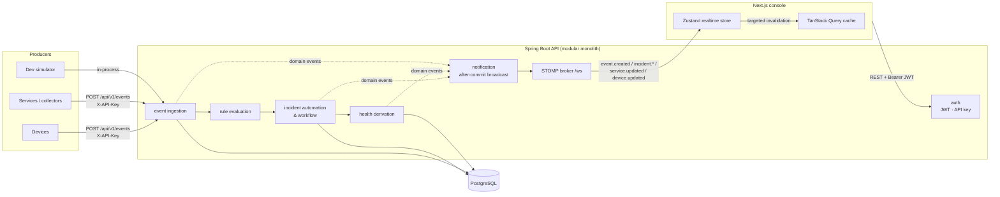
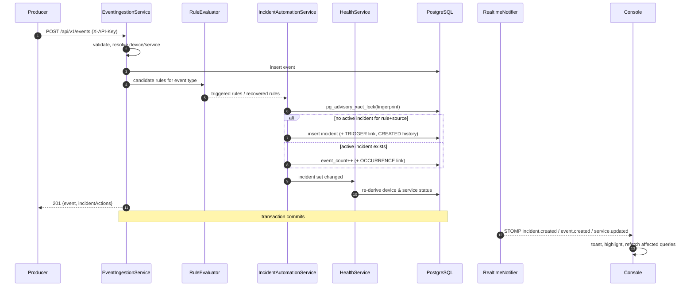
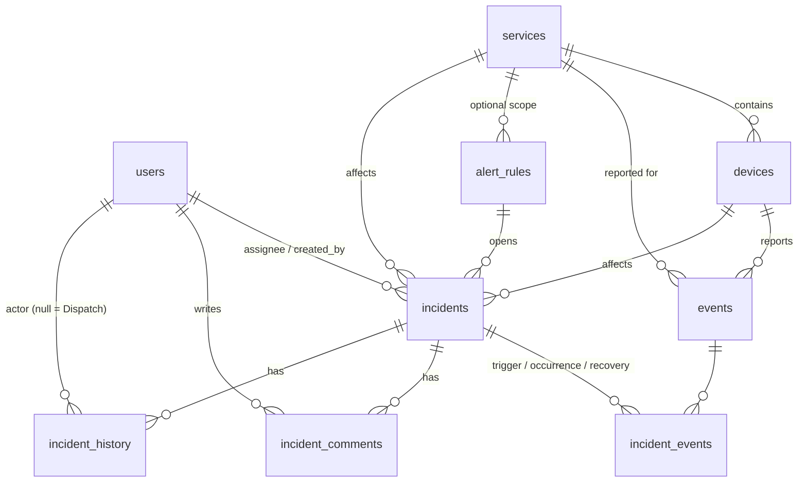

# Dispatch

**Real-time incident management for devices, services and infrastructure.**

Dispatch receives events from monitored devices and services, evaluates them against alert rules,
turns real problems into incidents, and streams every change to an operations console over WebSockets.
Operators acknowledge, assign, discuss and resolve incidents, while Dispatch keeps the noise down:
repeated alerts fold into the incident that is already open, and problems that clear themselves close
themselves (unless someone is already working on them).

```text
Event ─▶ Rule evaluation ─▶ Incident (created / de-duplicated / recovered) ─▶ WebSocket ─▶ Live UI
```

<!--
Screenshots: capture them as described in docs/screenshots/README.md, then uncomment.


-->

---

## Contents

- [Features](#features)
- [Architecture](#architecture)
- [Tech stack](#tech-stack)
- [Run it locally](#run-it-locally)
- [Demo credentials](#demo-credentials)
- [Environment variables](#environment-variables)
- [How an event becomes an incident](#how-an-event-becomes-an-incident)
- [API overview](#api-overview)
- [Real-time (WebSocket) overview](#real-time-websocket-overview)
- [Data model](#data-model)
- [Testing](#testing)
- [Project structure](#project-structure)
- [Known limitations](#known-limitations)
- [Future improvements](#future-improvements)

Deeper dives: [`docs/architecture.md`](docs/architecture.md) · [`docs/api.md`](docs/api.md) ·
[`docs/project-summary.md`](docs/project-summary.md) (one-page summary)

---

## Features

**Detection**
- Event ingestion API for devices, services and external integrations (`X-API-Key` authenticated).
- Alert rules with three condition types: *event type*, *metric threshold* (`cpu > 90`, nested metadata
  keys) and *minimum severity*, optionally scoped to one service.
- **De-duplication**: one active incident per *rule + source*. A device reporting OFFLINE every few seconds
  produces one incident with a growing event count, not hundreds of pages. Guaranteed under concurrency
  by a PostgreSQL advisory lock plus a partial unique index.
- **Recovery handling**: a rule's recovery event auto-resolves the incident only if nobody has started
  investigating. Otherwise the incident is flagged *Recovered* and left for an operator to confirm.
  Rules for severe outages can require confirmation always. Recurrence clears the flag.
- **Derived health**: service and device status (Healthy / Degraded / Down, Online / Degraded / Offline)
  is computed from connectivity events and impacting incidents, so it always agrees with the incident list.

**Response**
- Incident list with search (title, `INC-123`, device id), status/severity/service/assignee filters,
  sorting and pagination, all reflected in the URL.
- Incident page: severity, status, recovery state, summary, rule provenance, a unified activity timeline
  (audit history + comments), related events (trigger / repeats / recovery), and details such as time to
  acknowledge and duration.
- Commands: acknowledge (moves to Investigating and takes ownership), assign, change severity, comment,
  resolve with a note, reopen (blocked if a newer incident already tracks the same problem), declare an
  incident manually.
- Every change is written to an append-only incident history.

**Live operations console**
- Dashboard: active incidents by severity, unassigned count, MTTA/MTTR, event throughput sparkline,
  hourly incident trend, service health and a live event feed.
- Everything updates over WebSockets without polling; changed rows briefly highlight, and new
  HIGH/CRITICAL incidents raise a toast. A connection indicator shows whether the screen is live.
- Event stream with keyset pagination, filters, pause/resume and an event inspector.
- Admin tools: rule editor with a live preview, service/device registry, team management, a
  "send test event" composer that shows exactly what the pipeline did, and simulator controls.

**Engineering**
- JWT authentication (Spring Security resource server), BCrypt passwords, role-based authorization
  (ADMIN / OPERATOR / INGEST) enforced in the API and reflected in the UI. Roles and deactivation take
  effect on the next request, not when the token expires.
- RFC 9457 problem-details errors with stable codes, field errors and request ids, surfaced as
  specific messages in the UI.
- Flyway migrations, `ddl-auto=validate`, indexes for every hot query, no N+1 queries on list endpoints.
- A development event simulator that runs through the real ingestion pipeline.
- 97 backend tests (unit + Testcontainers integration incl. WebSocket and concurrency), 67 frontend tests.
- One-command local environment with Docker Compose.

## Architecture

A **modular monolith**: one Spring Boot service with clearly separated modules, one PostgreSQL database
and a Next.js console. No message broker or microservices are needed at this scale.
See [`docs/architecture.md`](docs/architecture.md) for the details and the design decisions.



Backend modules (`com.dispatch.*`): `auth`, `user`, `service`, `device`, `event`, `rule`, `incident`,
`health`, `dashboard`, `notification`, `websocket`, `simulator`, `seed`, `common`.

## Tech stack

| Layer | Technology |
|---|---|
| Backend | Java 25, Spring Boot 4.1 (Spring Framework 7), Spring Web MVC, Spring Data JPA (Hibernate 7), Spring Security 7 (OAuth2 resource server, JWT), Bean Validation, STOMP over WebSocket |
| Database | PostgreSQL 18, Flyway migrations |
| Frontend | Next.js 16 (App Router), React 19, TypeScript, Tailwind CSS 4, TanStack Query 5, Zustand 5, @stomp/stompjs |
| Testing | JUnit 5, Mockito, AssertJ, MockMvc, Testcontainers; Vitest, React Testing Library |
| Infrastructure | Docker, Docker Compose, GitHub Actions CI |

## Run it locally

**Requirements:** Docker Desktop (or Docker Engine with Compose v2). Nothing else is required.

```bash
git clone https://github.com/AravindAB5/Dispatch.git
cd Dispatch
docker compose up --build
```

Then open **http://localhost:3000** and sign in with a [demo account](#demo-credentials).

On first start the API runs its Flyway migrations, seeds a realistic dataset (48 hours of history) and
starts the event simulator, so the dashboard is busy immediately. Stop with `Ctrl+C`; reset all data with
`docker compose down -v`.

| Service | URL |
|---|---|
| Console | http://localhost:3000 |
| API | http://localhost:8080/api/v1 |
| Health check | http://localhost:8080/actuator/health |
| PostgreSQL | `localhost:5432`, database / user / password `dispatch` |

Try the pipeline from a terminal while watching the dashboard:

```bash
./scripts/demo.sh DEVICE-042     # offline → repeats (de-duplicated) → recovery (auto-resolved)
```

### Running the parts without Docker

```bash
# 1. Database only
docker compose up -d postgres

# 2. API (JDK 25). Seed data and simulator on.
cd backend
DISPATCH_SEED_ENABLED=true DISPATCH_SIMULATOR_ENABLED=true DISPATCH_SIMULATOR_AUTO_START=true ./mvnw spring-boot:run

# 3. Console (Node 24)
cd frontend
npm install
npm run dev
```

## Demo credentials

Development data only. Seeded when `DISPATCH_SEED_ENABLED=true` and the database is empty.

| Account | Password | Role | Notes |
|---|---|---|---|
| `admin@dispatch.local` | `admin123` | Administrator | Manages rules, services, devices, team, simulator |
| `operator@dispatch.local` | `operator123` | Operator | Works incidents (Aravind B) |
| `priya@dispatch.local`, `marcus@dispatch.local`, `sofia@dispatch.local` | `operator123` | Operator | Other team members |
| `daniel@dispatch.local` | `operator123` | Operator | Deactivated; sign-in is refused |

Event producers authenticate with the ingestion key `dispatch-dev-ingest-key` (header `X-API-Key`).

## Environment variables

All variables have development defaults; copy [`.env.example`](.env.example) to `.env` to override them
for Docker Compose.

| Variable | Default | Purpose |
|---|---|---|
| `DATABASE_URL` | `jdbc:postgresql://localhost:5432/dispatch` | JDBC URL (Compose sets the container address) |
| `DATABASE_USERNAME` / `DATABASE_PASSWORD` | `dispatch` / `dispatch` | Database credentials |
| `DISPATCH_JWT_SECRET` | development value | HS256 signing key, **≥ 32 bytes**. Must be changed outside development; the API logs a warning while the default is in use |
| `DISPATCH_JWT_TTL` | `12h` | Access token lifetime |
| `DISPATCH_INGEST_API_KEY` | `dispatch-dev-ingest-key` | Key event producers send in `X-API-Key` |
| `DISPATCH_CORS_ALLOWED_ORIGINS` | `http://localhost:3000` | Comma-separated origins allowed for REST and WebSocket |
| `DISPATCH_SEED_ENABLED` | `false` (`true` in Compose) | Seed demo data into an empty database |
| `DISPATCH_SIMULATOR_ENABLED` | `false` (`true` in Compose) | Register the event simulator and its endpoints |
| `DISPATCH_SIMULATOR_AUTO_START` | `false` (`true` in Compose) | Start the simulator on boot |
| `DISPATCH_SIMULATOR_INTERVAL` | `3s` | Delay between simulator ticks |
| `DISPATCH_ADMIN_EMAIL` / `DISPATCH_ADMIN_PASSWORD` | empty | Creates the first administrator on an empty database without seed data (password ≥ 12 chars) |
| `NEXT_PUBLIC_API_URL` | `http://localhost:8080` | How the *browser* reaches the API (build-time) |
| `NEXT_PUBLIC_SHOW_DEMO_CREDENTIALS` | `true` in Compose | Show the demo account panel on the login page (build-time) |

## How an event becomes an incident



1. **Validate & persist.** The payload is validated (Bean Validation plus source checks). The event is stored with its JSON metadata.
2. **Evaluate rules.** Only candidate rules are loaded (same event type, same recovery type, or severity rules). A strategy per condition type decides whether each one matches.
3. **Create or de-duplicate.** A fingerprint (`rule:{id}|device:{id}` or `…|service:{id}`) identifies the ongoing problem. Under a transaction-scoped advisory lock, Dispatch either opens an incident or attaches the event to the open one.
4. **Recover.** A matching recovery event auto-resolves `OPEN` incidents. `INVESTIGATING` incidents, and rules that require confirmation, are only flagged *Recovered*.
5. **Derive health.** Device and service status is recomputed from connectivity and impacting incidents.
6. **Broadcast after commit.** Domain events are delivered to WebSocket subscribers only once the transaction commits, so clients never see data that was rolled back.

## API overview

All endpoints are under `/api/v1` and return JSON. Errors use RFC 9457 problem details.
Full reference with examples: [`docs/api.md`](docs/api.md).

| Area | Endpoints | Access |
|---|---|---|
| Auth | `POST /auth/login`, `GET /auth/me` | public / any user |
| Events | `POST /events` · `GET /events` (keyset cursor) · `GET /events/{id}` · `GET /events/types` | ingest key or ADMIN / any user |
| Incidents | `GET /incidents` · `GET /incidents/{id}` · `GET /incidents/{id}/history` · `/comments` · `/events` | any user |
| Incident commands | `POST /incidents` · `PUT /incidents/{id}/assignee` · `/status` · `/severity` · `POST /incidents/{id}/comments` | ADMIN, OPERATOR |
| Rules | `GET /rules` · `POST /rules` · `PUT/PATCH/DELETE /rules/{id}` | read: any user · write: ADMIN |
| Services | `GET /services` · `GET /services/{id}` · `POST /services` · `PUT /services/{id}` | read: any user · write: ADMIN |
| Devices | `GET /devices` · `GET /devices/{id}` · `POST /devices` · `PUT /devices/{id}` | read: any user · write: ADMIN |
| Users | `GET /users` · `POST /users` · `PATCH /users/{id}` | read: any user · write: ADMIN |
| Dashboard | `GET /dashboard/summary` · `/incident-trend?hours=24&tz=…` · `/event-volume?minutes=60` | any user |
| Simulator | `GET /simulator` · `POST /simulator/start` · `POST /simulator/stop` | dev only · start/stop: ADMIN |

```bash
curl -X POST http://localhost:8080/api/v1/events \
  -H "Content-Type: application/json" -H "X-API-Key: dispatch-dev-ingest-key" \
  -d '{"eventType":"CPU_USAGE_HIGH","severity":"HIGH","sourceType":"DEVICE","sourceId":"DEVICE-042",
       "message":"CPU usage reached 94%","metadata":{"cpu":94,"threshold":90}}'
```

```json
{
  "event": { "id": 1203, "eventType": "CPU_USAGE_HIGH", "sourceId": "DEVICE-042", "incidents": [ … ] },
  "incidentActions": [
    { "type": "CREATED", "key": "INC-61", "title": "High CPU usage on DEVICE-042 (94%)",
      "severity": "HIGH", "status": "OPEN", "ruleName": "High CPU usage" }
  ]
}
```

## Real-time (WebSocket) overview

STOMP over a plain WebSocket at `ws://localhost:8080/ws`. The browser sends its JWT in the STOMP
`CONNECT` frame (`Authorization: Bearer …`). Clients may subscribe but never publish.

| Topic | Message `type` | `data` |
|---|---|---|
| `/topic/events` | `event.created` | the stored event, including linked incidents |
| `/topic/incidents` | `incident.created`, `incident.updated`, `incident.resolved` | incident summary |
| `/topic/services` | `service.updated` | `{id, name, status, previousStatus, statusChangedAt}` |
| `/topic/devices` | `device.updated` | `{id, identifier, status, previousStatus, lastSeenAt}` |

Every message is `{"type": "...", "data": {...}, "sentAt": "..."}`. The console treats messages as
*signals*. It appends events to a bounded live buffer (Zustand) and invalidates exactly the TanStack
Query keys affected, coalescing bursts, so the server stays the source of truth. After a reconnect
every query is refreshed, because messages sent while offline are not replayed.

## Data model



| Table | Highlights |
|---|---|
| `events` | immutable; `metadata JSONB`; indexes on `(occurred_at DESC, id DESC)` for keyset paging and per type/severity/service/device |
| `incidents` | `fingerprint` + **partial unique index** `WHERE status <> 'RESOLVED'`; generated `severity_rank` column for sorting; `@Version` optimistic locking; CHECK that `resolved_at` is set iff `RESOLVED` |
| `incident_events` | join table carrying the relation (TRIGGER / OCCURRENCE / RECOVERY) |
| `incident_history` | append-only audit trail with actor, from/to values and message |
| `alert_rules` | CHECK constraints enforce the fields each condition type needs |

Schema: [`backend/src/main/resources/db/migration`](backend/src/main/resources/db/migration).

## Testing

```bash
# Backend: unit + integration (Testcontainers starts PostgreSQL; needs JDK 25 and Docker)
cd backend && ./mvnw test

# …or without a local JDK, inside Docker
docker run --rm -v "$PWD/backend":/src -v /var/run/docker.sock:/var/run/docker.sock \
  -e TESTCONTAINERS_HOST_OVERRIDE=host.docker.internal -w /src maven:3.9-eclipse-temurin-25 mvn -B test

# Frontend
cd frontend && npm test           # Vitest + React Testing Library
npm run lint && npm run typecheck && npm run build

# End-to-end smoke test against a running stack (docker compose up)
./scripts/smoke-test.sh           # 19 checks: auth, ingestion, de-dup, workflow, history, RBAC, validation
```

What is covered:

| Suite | Focus |
|---|---|
| `RuleEvaluatorTest` | each condition type, thresholds and operators, nested/string metrics, scope, disabled rules, fail-fast wiring |
| `IncidentAutomationServiceTest` | creation, de-duplication, separate sources, recovery (OPEN vs INVESTIGATING vs confirmation-required), recurrence |
| `IncidentTest`, `IncidentServiceTest` | lifecycle transitions, reopen conflicts, assignment rules, audit history |
| `HealthServiceTest` | service and device health derivation rules |
| `EventIngestionIntegrationTest` | full pipeline over HTTP against PostgreSQL, **8 concurrent duplicates → exactly one incident**, concurrent mixed events never overwrite device status, validation, keyset paging |
| `IncidentWorkflowIntegrationTest` | operator flow end to end, history order, conflicts, filters/sort/paging, dashboard aggregates |
| `AuthIntegrationTest` | login, generic credential errors, deactivated users, immediate revocation and role changes, token tampering, RBAC, API key scope |
| `WebSocketIntegrationTest` | real STOMP client: authenticated subscribe, after-commit delivery, refusal without a valid token |
| Frontend | URL filter round-trip, activity merge, live-event merge, realtime message routing, API error handling, open-redirect protection, login and incident action components |

CI ([`.github/workflows/ci.yml`](.github/workflows/ci.yml)) runs all of the above and builds the Docker images.

## Project structure

```text
dispatch/
├── backend/                     Spring Boot API
│   ├── src/main/java/com/dispatch/
│   │   ├── auth/                security config, JWT, API-key filter, login
│   │   ├── user/                users & roles
│   │   ├── service/ device/     monitored services and devices
│   │   ├── event/               ingestion pipeline, keyset search
│   │   ├── rule/                alert rules + evaluation strategies
│   │   ├── incident/            aggregate, automation (dedup/recovery), workflow, queries
│   │   ├── health/              derived service/device status
│   │   ├── dashboard/           aggregates (SQL with generate_series)
│   │   ├── notification/ websocket/   after-commit broadcast, STOMP config & auth
│   │   ├── simulator/ seed/     development tooling
│   │   └── common/              errors (problem details), paging, request ids
│   └── src/main/resources/db/migration/   Flyway
├── frontend/                    Next.js console
│   └── src/
│       ├── app/                 routes (login, dashboard, incidents, events, …), proxy.ts guard
│       ├── components/          feature components + small UI kit
│       ├── lib/                 API client, domain helpers, realtime message handling
│       └── stores/              Zustand (realtime, toasts, clock)
├── docs/                        architecture, API reference, screenshots
├── scripts/demo.sh              scripted incident walkthrough
└── docker-compose.yml
```

## Known limitations

- **Single API instance for real time.** The STOMP broker is in-memory. Running several instances requires a broker relay (RabbitMQ/ActiveMQ) or a shared pub/sub.
- **Session model is simple.** The access token lives in a JS-readable cookie (so the Next.js proxy can guard routes) and there are no refresh tokens or server-side logout. Production would use short-lived tokens with refresh rotation in an httpOnly cookie, or an external identity provider.
- **One shared ingestion key**, with no per-producer keys, scopes or rotation, and no rate limiting on login or ingestion.
- **Synchronous processing.** Rules run inside the ingestion request. That's fine for this scale; very high event volumes would move to a queue with batched evaluation.
- **No retention.** The `events` table grows without bounds (no partitioning or archival).
- **No missed-heartbeat detection.** A device that silently disappears is only noticed if something reports it offline.
- Deleting a rule keeps its incidents but they can no longer auto-recover (disable a rule instead).
- The console ships a dark theme only.

## Future improvements

- Escalation policies and on-call schedules (re-notify or escalate unacknowledged incidents after N minutes).
- Notification integrations: email, Slack/Teams, webhooks, PagerDuty-style phone/SMS.
- Richer rules: sustained conditions ("> 90% for 5 minutes"), rate-based rules, compound conditions, maintenance windows and silences.
- Heartbeat-timeout detection with a scheduled job, and per-device expected intervals.
- Incident relationships: parent/child incidents, grouping alerts from one root cause.
- Audit improvements: configuration audit log (who changed which rule), export, retention policies.
- External monitoring integrations: Prometheus Alertmanager, Datadog, CloudWatch webhooks.
- Horizontal scaling: STOMP broker relay, idempotency keys on ingestion, event partitioning.
- Post-incident reviews: timeline export and root-cause fields.
