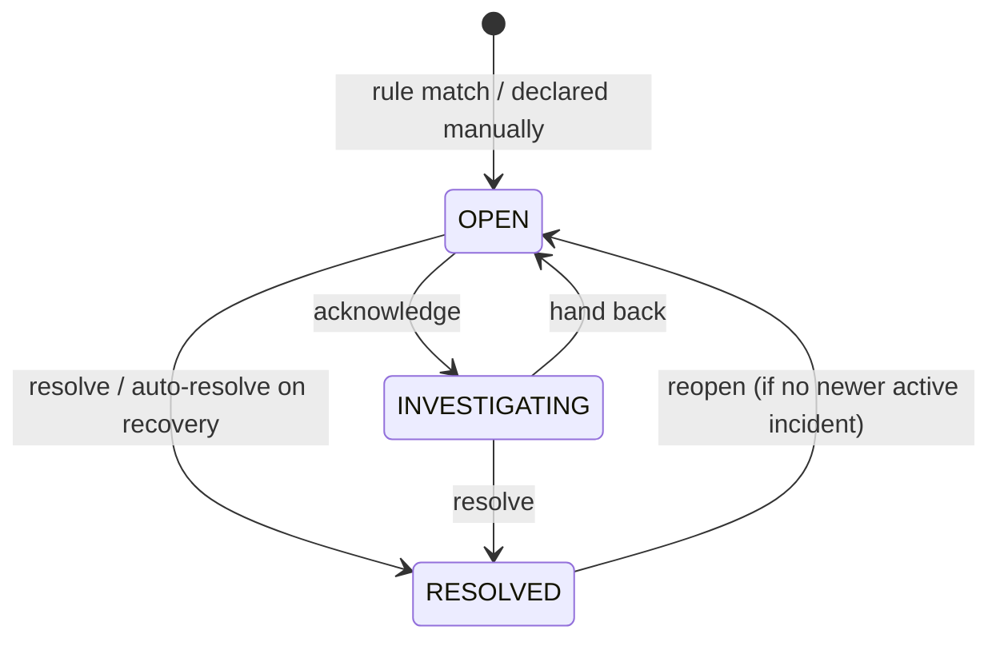

# Architecture

This document explains how Dispatch is put together and *why*. For the quick tour, start with the
[README](../README.md).

- [System overview](#system-overview)
- [Backend modules](#backend-modules)
- [The event pipeline](#the-event-pipeline)
- [Rule evaluation](#rule-evaluation)
- [De-duplication](#de-duplication)
- [Recovery](#recovery)
- [Incident lifecycle](#incident-lifecycle)
- [Health derivation](#health-derivation)
- [Real-time delivery](#real-time-delivery)
- [Security](#security)
- [Persistence](#persistence)
- [Error handling](#error-handling)
- [Frontend architecture](#frontend-architecture)
- [Simulator and seed data](#simulator-and-seed-data)
- [Design decisions](#design-decisions)

---

## System overview

```text
                     ┌──────────────────────────┐
                     │      Next.js console     │  App Router · TanStack Query · Zustand
                     │  dashboard · incidents   │
                     │  events · services · …   │
                     └────────────┬─────────────┘
                     REST (Bearer JWT) │ STOMP over WebSocket (JWT in CONNECT)
                                  ▼
                     ┌──────────────────────────┐
  producers ───────▶ │     Spring Boot API      │  modular monolith
  (X-API-Key)        │ ingestion · rules ·      │
                     │ incidents · health ·     │
                     │ notification · audit     │
                     └────────────┬─────────────┘
                                  ▼
                     ┌──────────────────────────┐
                     │       PostgreSQL 18      │  Flyway-managed schema
                     └──────────────────────────┘
```

Three deployable parts and no other infrastructure. A message broker, cache or separate worker would
add operational weight without solving a problem this system has at its scale; the places where that
would change are listed under [Design decisions](#design-decisions).

## Backend modules

Packages under `com.dispatch`, each owning its entities, repositories, services and controllers:

| Module | Responsibility |
|---|---|
| `auth` | Security filter chain, JWT issue/validation, ingestion API-key filter, login, 401/403 problem responses |
| `user` | Users and roles (ADMIN, OPERATOR) |
| `service`, `device` | Registry of monitored services and devices |
| `event` | `EventIngestionService` (the pipeline orchestrator), keyset-paginated event search |
| `rule` | Alert rule definitions and CRUD; `rule.evaluation` holds the pure rule engine |
| `incident` | The `Incident` aggregate, `IncidentAutomationService` (rule matches → incidents), `IncidentService` (operator commands), queries, history |
| `health` | Derives device and service status |
| `dashboard` | Read-side aggregates (counts, MTTA/MTTR, time buckets) |
| `notification` | Bridges domain events to WebSocket topics after commit |
| `websocket` | STOMP endpoint, broker configuration, CONNECT authentication |
| `simulator`, `seed` | Development tooling, enabled by configuration |
| `common` | Problem-details error handling, paging DTOs, request-id correlation, clock |

Layering inside a module is Controller → Service → Repository/Entity, with DTOs (Java records) at the
API boundary. Business rules live in services and, where they concern a single aggregate, in the entity
itself (`Incident.transitionTo`, `assignTo`, `recordOccurrence`). Controllers only translate HTTP.
Interfaces are used where there are genuinely multiple implementations (`RuleConditionEvaluator`), not
by default.

## The event pipeline

`EventIngestionService.ingest` runs one database transaction per event:

1. **Validate.** Bean Validation on the request (`UPPER_SNAKE_CASE` type, required fields, metadata size), then
   source checks: the device must be registered, the service must exist, `SERVICE` events need a
   `serviceId`, a device cannot be attributed to another service, and the timestamp cannot be more than
   5 minutes in the future.
2. **Persist** the event. Metadata is stored as `JSONB`, and timestamps are truncated to microseconds to
   match PostgreSQL precision, which keeps keyset cursors exact.
3. **Automate.** `IncidentAutomationService.process` evaluates rules and creates, de-duplicates or recovers
   incidents. It returns a list of `IncidentAction`s (`CREATED`, `DEDUPLICATED`, `RECURRED`,
   `RECOVERY_DETECTED`, `AUTO_RESOLVED`).
4. **Re-derive health** for the reporting device and for any device or service whose set of impacting
   incidents changed.
5. **Publish** an `EventRecordedEvent` carrying the event *and* the incidents it touched.

The HTTP response contains the stored event and the `incidentActions`, so a producer (or the admin
"send test event" tool) can see exactly what its event caused.

Because the pipeline is one transaction, an event and its incident changes are atomic: an incident never
exists without the event that triggered it, and clients are notified only after both are committed.

## Rule evaluation

`rule.evaluation` is a small, pure strategy-based engine with no persistence and no side effects:

```text
EventFacts ──▶ RuleEvaluator ──▶ triggered rules ─┐
                    │                              ├─▶ IncidentAutomationService
                    └────────▶ recovered rules ────┘
```

- `EventFacts` is a record of the attributes rules can see (type, severity, source, service, device,
  metadata). Decoupling it from the JPA entity makes the evaluator trivially unit-testable.
- `RuleConditionEvaluator` has one implementation per `RuleConditionType`:
  - `EventTypeCondition`: `WHEN event type = X`
  - `MetricThresholdCondition`: `WHEN event type = X AND metadata[key] <op> threshold`. Supports dotted
    paths (`disk.root`) and numeric strings, and never matches when the metric is missing.
  - `SeverityAtLeastCondition`: `WHEN severity ≥ S [AND type = X]`
- `RuleEvaluator` collects all evaluators into an `EnumMap` and **refuses to start** if a condition type has
  no evaluator. Adding a rule type means one enum constant plus one `@Component`; nothing else changes.
- Scope: a rule with a `service` only applies to that service's events.
- Recovery matching deliberately includes **disabled** rules, so incidents opened before a rule was
  disabled can still recover.
- The repository loads only *candidate* rules for an event (same `event_type`, same `recovery_event_type`,
  or severity rules), using indexed columns.

There is intentionally no expression language. A small typed model is easier to validate (the API
enforces per-type required fields, and the database has CHECK constraints) and easier to render in the
UI as plain language ("WHEN cpu > 90 on CPU_USAGE_HIGH THEN open a HIGH incident UNTIL CPU_USAGE_NORMAL").

## De-duplication

A **fingerprint** identifies "the same ongoing problem":

```text
rule:{ruleId}|device:{deviceId}          device events
rule:{ruleId}|service:{serviceId}        service-level events
rule:{ruleId}|external:{SOURCE-ID}       external integrations
```

When a rule matches:

```text
acquire pg_advisory_xact_lock(hashtext(fingerprint))
find unresolved incident with this fingerprint
  ├─ none  → create incident, link event as TRIGGER, history CREATED
  └─ found → event_count++, last_event_at, link event as OCCURRENCE
             (if it had been flagged recovered → clear flag, history RECURRED)
```

Correctness under concurrency rests on two layers:

1. **Transaction-scoped advisory lock** on the fingerprint. Two simultaneous `DEVICE_OFFLINE` events
   for the same device serialize at this point. The second transaction acquires the lock only after the
   first commits, so under READ COMMITTED it sees the new incident and attaches to it. The lock is released
   automatically on commit or rollback.
2. **Partial unique index** `ux_incidents_active_fingerprint ON incidents(fingerprint) WHERE status <> 'RESOLVED'`.
   Even if application logic were bypassed, the database refuses a second active incident for one problem.

`EventIngestionIntegrationTest.concurrentDuplicatesProduceExactlyOneIncident` fires 8 identical events
in parallel against real PostgreSQL and asserts exactly one incident with `event_count = 8`.

**Device and service status under concurrency.** Ingestion loads the reporting device with a row lock
(`SELECT … FOR UPDATE`), so events for one device are processed one at a time, and `Device` uses
`@DynamicUpdate` so a "last seen" write never rewrites the status column. Health derivation re-reads and
locks the service row before computing its status; that lock is always the last one taken, which keeps the
lock order acyclic (device → fingerprint → service). If an operator edits the same incident at the same
moment, the optimistic-lock conflict is retried with a fresh transaction (up to three attempts) instead of
dropping the event.

Repeats deliberately do **not** write history entries (that would flood the timeline). They are visible as
the event count and as `OCCURRENCE` links under *Related events*.

## Recovery

A rule may name a `recoveryEventType` (e.g. `DEVICE_OFFLINE` recovers on `DEVICE_RECOVERED`). When a
recovery event arrives for a fingerprint with an active incident:

| Incident state | Rule `autoResolve` | Outcome |
|---|---|---|
| `OPEN` (nobody working on it) | true | **Auto-resolved.** History `AUTO_RESOLVED`, actor = Dispatch |
| `INVESTIGATING` | true | **Flagged recovered**, left open. Someone is working on it and may still need to finish (root cause, cleanup) |
| any | false | **Flagged recovered**, left open. Used for severe outages that need human confirmation |
| none | – | Nothing happens; the event is still stored |

A recovered-but-open incident shows a *Recovered* chip and a "Confirm & resolve" banner in the UI. If the
problem fires again, the flag is cleared and a `RECURRED` entry is recorded. Resolving an incident never
discards history: reopening is allowed unless a newer incident is already tracking the same fingerprint
(this is checked under the same advisory lock).

## Incident lifecycle



The transition table lives in `IncidentStatus.canTransitionTo`, and the side effects live in
`Incident.transitionTo`:
- First move to `INVESTIGATING` sets `acknowledged_at` (the basis of MTTA).
- `RESOLVED` sets `resolved_at` and the resolution note (MTTR).
- Reopening clears resolution and recovery fields.

Resolved incidents reject reassignment and severity changes (`INCIDENT_RESOLVED`). Comments are always allowed.
Every command writes an `incident_history` row with actor, from/to values and a human-readable message.

## Health derivation

Health is **derived, never set by hand**, so it always agrees with what operators see. An incident is
*impacting* if it is unresolved and not flagged as recovered.

**Device**
- `OFFLINE` after `DEVICE_OFFLINE`, until `DEVICE_RECOVERED` or a heartbeat arrives.
- Otherwise `DEGRADED` while it has an impacting incident of `MEDIUM` severity or above, else `ONLINE`.

**Service**
- `DOWN` with an impacting `CRITICAL` service-level incident, or when more than half its devices are offline.
- `DEGRADED` with an impacting `HIGH`+ service-level incident, a `CRITICAL` device incident, or any
  offline device. One node running hot does not degrade a whole service.
- `HEALTHY` otherwise.

`HealthService` recomputes only what could have changed (the reporting device on connectivity events, and
devices/services whose impacting incidents changed). It publishes `DeviceStatusChangedEvent` /
`ServiceStatusChangedEvent` only on actual transitions.

## Real-time delivery

```text
transaction ──publishEvent──▶ ApplicationEventPublisher
                                   │  (held until commit)
                                   ▼
           @TransactionalEventListener(AFTER_COMMIT) RealtimeNotifier
                                   │
                                   ▼
          SimpMessagingTemplate ──▶ in-memory STOMP broker ──▶ /topic/* subscribers
```

- Domain events carry **snapshots** (DTOs built inside the transaction), so the after-commit listener
  needs no extra queries and cannot observe later changes.
- `AFTER_COMMIT` guarantees clients never hear about rolled-back data, and that a follow-up REST call
  sees what the message described.
- `StompAuthChannelInterceptor` validates the JWT in the STOMP `CONNECT` frame with the same `JwtDecoder`
  as the REST API. Browsers cannot set headers on the WebSocket handshake, which is why the token goes in
  the frame. Subscriptions are limited to the four known topics, and `SEND` is rejected (the channel is
  read-only for clients).
- Broker heart-beats (10 s) detect dead connections. The client reconnects every 3 s and refetches
  everything after a reconnect, since the broker does not replay missed messages.

## Security

| Concern | Approach |
|---|---|
| User authentication | `POST /auth/login` checks BCrypt (`DelegatingPasswordEncoder`) and returns an HS256 JWT (`sub`, `email`, `name`, `roles`, `iss`, `exp`) issued with Spring Security's `NimbusJwtEncoder` |
| Token validation | Spring Security OAuth2 resource server (`NimbusJwtDecoder` with issuer validation). `ActiveUserJwtConverter` then loads the user by `sub` (one primary-key lookup) and grants the *current* role, so deactivation and role changes take effect on the next request (REST and STOMP alike) rather than at token expiry |
| Machine authentication | `ApiKeyAuthenticationFilter`: `X-API-Key` compared in constant time → `ROLE_INGEST`, which may only `POST /api/v1/events` |
| Authorization | URL rules for coarse access (ingest vs users), `@PreAuthorize("hasRole('ADMIN')")` on administrative operations |
| Enumeration resistance | Unknown email and wrong password return the same error, and a decoy hash is checked for unknown emails so response timing matches |
| Session state | Stateless; CSRF disabled because the API never authenticates from cookies |
| Secrets | JWT secret must be ≥ 32 bytes (startup fails otherwise), and a warning is logged while the development default is used |
| CORS | Explicit allowed origins for REST and the WebSocket endpoint |
| Containers | Both images run as non-root users |

On the frontend, `src/proxy.ts` (Next.js 16's renamed middleware) redirects signed-out visitors before any
console page renders. It decodes the token's `exp` for an optimistic check, while the API remains the
authority. Post-login redirects only accept same-origin relative paths (open-redirect protection, unit-tested).

## Persistence

- **Flyway** owns the schema (`V1__initial_schema.sql`), and Hibernate runs with `ddl-auto=validate`, so
  entity/schema drift fails at startup instead of at runtime.
- Enums are stored as `VARCHAR` with `CHECK` constraints: readable in SQL and still enforced.
- Integrity constraints encode business invariants: `resolved_at` set iff `RESOLVED`; per-condition-type
  required rule fields; the partial unique index for active fingerprints.
- **Indexes** follow the queries: `(status, severity_rank, created_at)` for the incident list,
  `(occurred_at DESC, id DESC)` for the event stream, `(event_type, occurred_at)`,
  `(service_id, occurred_at)`, `(device_id, occurred_at)`, FKs used in filters, `lower(email)` unique.
- **No N+1**: list endpoints use `@EntityGraph` or fetch joins for the to-one associations they render.
  Aggregate counts are grouped queries keyed by id (`ServiceCatalog.list()` is 3 queries regardless of
  the number of services). `default_batch_fetch_size` is a safety net.
- **Keyset pagination** for events (`WHERE (occurred_at, id) < (cursor)`, opaque base64 cursor, one extra
  row instead of `COUNT(*)`). Offset pagination for incidents and devices, where totals are useful and
  tables are small.
- **Optimistic locking** (`@Version`) on incidents turns lost updates into a 409 with a clear message.
- **Dashboard** time series use plain SQL through `JdbcClient` (`generate_series` + `FILTER`), with hour
  buckets aligned to the caller's time zone so labels fall on whole local hours.

## Error handling

Every error is an RFC 9457 problem detail with stable extension members:

```json
{
  "type": "https://dispatch.local/problems/validation-failed",
  "title": "Validation failed",
  "status": 400,
  "detail": "sourceId: no device is registered with identifier DEVICE-999",
  "code": "VALIDATION_FAILED",
  "errors": [{ "field": "sourceId", "message": "no device is registered with identifier DEVICE-999" }],
  "requestId": "9bb71f07-a9c1-4da0-bd18-99384ac3cf5f",
  "timestamp": "2026-10-08T17:59:44.745Z"
}
```

| Status | When | Example `code`s |
|---|---|---|
| 400 | Bean Validation, malformed JSON (with allowed enum values), bad parameters, cross-field validation | `VALIDATION_FAILED`, `MALFORMED_REQUEST`, `INVALID_PARAMETER` |
| 401 | Missing/invalid token or API key, wrong credentials | `UNAUTHENTICATED`, `TOKEN_INVALID`, `API_KEY_INVALID`, `INVALID_CREDENTIALS` |
| 403 | Role not allowed, deactivated account | `FORBIDDEN`, `ACCOUNT_DISABLED` |
| 404 | Unknown resource or route | `NOT_FOUND` |
| 409 | Conflicts and concurrent edits | `ACTIVE_DUPLICATE_EXISTS`, `EMAIL_TAKEN`, `CONCURRENT_MODIFICATION` |
| 422 | Valid request that breaks a domain rule | `INVALID_STATUS_TRANSITION`, `INCIDENT_RESOLVED`, `LAST_ADMIN` |
| 500 | Anything unexpected (logged with the request id, details hidden) | `INTERNAL_ERROR` |

`RequestIdFilter` assigns every request an id, exposes it in logs via MDC and returns it in `X-Request-Id`.
The frontend maps problems to specific messages, highlights field errors on form inputs, and shows the
request id for server errors.

## Frontend architecture

| Concern | Choice |
|---|---|
| Rendering | Next.js App Router. Pages are thin server components rendering client feature components; data is fetched in the browser with the user's token |
| Server state | TanStack Query with hierarchical keys (`["incident", 41, "history"]`, `["incidents", query]`), `keepPreviousData` for paging, retries only on 5xx/network errors |
| Client state | Zustand for state that is genuinely global and not server data: socket status, the bounded live-event buffer, transient highlights, toasts, and a shared clock for relative timestamps |
| Real time | One STOMP client (`RealtimeProvider`). `handleRealtimeMessage` (pure, unit-tested) maps each message to effects: invalidate keys (coalesced per key), push to the live buffer, highlight, toast |
| Live lists | Event views merge the live buffer with fetched pages (`mergeLiveEvents`: filter-aware, de-duplicated, ordered). The stream holds new rows while the pointer is over it so nothing shifts under the cursor |
| Forms & errors | API problem details → `ApiError` with `fieldErrors`; `describeError` produces specific messages |
| Routing guard | `proxy.ts` checks the session cookie before rendering; the API client redirects on any 401 |
| UI | Small in-house kit on Tailwind 4 tokens and native elements (`<dialog>` for modals and drawers); severity always has a text label; charts are hand-built SVG with validated colours, hover/focus tooltips and a table view |

## Simulator and seed data

**Seed** (`DevDataSeeder`, `DISPATCH_SEED_ENABLED=true`, empty database only): 6 users, 8 services,
38 devices, 9 rules, about 1,100 events over 48 hours, 40 resolved incidents with realistic timelines
(auto-resolved, or acknowledged → commented → recovered → resolved, some with severity changes), and 12
active incidents (3 critical / 4 high / 3 medium / 2 low), including one recovered-awaiting-confirmation
and one declared manually. Timestamps are relative to the moment of seeding, and health is derived
afterwards so everything is consistent.

**Simulator** (`DISPATCH_SIMULATOR_ENABLED=true`): a single-threaded scheduler that emits heartbeats,
sub-threshold warnings, deployments and *problems* (CPU spikes, memory pressure, disk, device offline,
error rates, latency, degraded/down services) on random devices and services. Problems repeat while
they last (exercising de-duplication) and recover after a realistic delay; some never recover and wait
for an operator. It calls `EventIngestionService` directly, so it uses exactly the production pipeline.
When disabled, neither its beans nor its endpoints exist.

## Design decisions

| Decision | Why | Revisit when |
|---|---|---|
| Modular monolith | One deployable, transactional consistency between events and incidents, simple local setup | Independent scaling or ownership is needed (ingestion is the natural first split) |
| Synchronous rule evaluation in the ingest transaction | Atomic event + incident, immediate feedback to producers, simplest correct design | Ingestion volume needs buffering → put events on a queue, evaluate in workers |
| Advisory lock + partial unique index for de-dup | Correct under concurrency without serializable isolation or retries | Very high contention on one fingerprint |
| Derived health instead of stored manual status | Cannot disagree with incidents; no "forgot to flip it back" | Teams need manual overrides or maintenance modes |
| In-memory STOMP broker | Zero extra infrastructure | More than one API instance |
| JWT resource server instead of a hand-written filter | Uses Spring Security's validated code paths (signature, expiry, issuer, authorities) | An external IdP is introduced (switch the decoder to its JWKS) |
| Keyset pagination for events | Constant cost per page on an append-only, ever-growing table; stable under inserts | – |
| Snapshot DTOs in domain events + `AFTER_COMMIT` | No reads after commit, no notifications for rolled-back work | Cross-process delivery (outbox pattern) |
| Fixed rule types over an expression language | Validatable, explainable, safe, easy to render | Users need ad-hoc logic → add types first, a DSL last |
